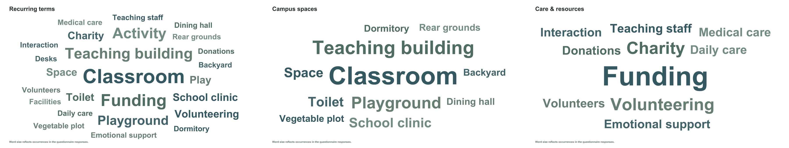

# Kuzhi Yucai Campus Research

Field research and a campus design study of Kuzhi Yucai Public Welfare School in Guiyang County, Hunan, China. The project connects questionnaire feedback, interviews, environmental assessment, activity observations, and spatial analysis with a campus proposal.

## Start here

| File | Purpose |
| --- | --- |
| [English research paper](outputs/paper/Kuzhi_Yucai_Campus_Research_EN.docx) | Current editable English manuscript, approximately 3,850 words, with word clouds, results, references, and appendices |
| [Editable English portfolio](outputs/portfolio/Campus_Research_Portfolio_EN.pptx) | Current 15-page A4 landscape research and design presentation |
| [Portfolio PDF](outputs/portfolio/Campus_Research_Portfolio_EN.pdf) | Readable export of the current presentation |
| [Data guide](docs/DATA_GUIDE.md) | Meaning of each dataset and its relationship to the source material |
| [Reproduction guide](docs/REPRODUCING.md) | Verification and analysis commands |
| [中文阅读说明](docs/README_ZH.md) | Chinese guide to this repository |

## Research

The study examines how classrooms, outdoor activity, sanitation, and everyday care connect across the school day. Analysis includes a 35-item environmental audit, literal keyword counts in written questionnaire answers, and the distribution of time between 06:30 and 21:00. The architectural proposal connects teaching wings, shared facilities, and a courtyard, with support located along everyday routes.

The English manuscript follows the structure Abstract, Introduction, Materials and methods, Results, Discussion, Conclusion, and References. Full questionnaire feedback and environmental scores appear in its appendices.

## Directory structure

```text
raw/             Original audio, questionnaires, photographs, maps, and drawings
data/            Processed tables, transcripts, extracted text, GIS layers, layouts
figures/         Word clouds, frequency charts, manuscript figures, design drawings
assets/          Image assets used by the editable presentation
outputs/         Current English paper and portfolio, plus companion editions
src/             Portable analysis commands and historical production scripts
docs/            Dataset descriptions, provenance, and reproduction instructions
archive/         Earlier Chinese report retained for project history
```

All directory names and project-facing file names use English or ASCII. Original Chinese answers and transcripts retain their source language.

## Word clouds

Three panels show recurring terms, campus spaces, and care and resources. Counts come from the Chinese questionnaire answers; English labels are translations. Each term appears once in each panel. Font size is proportional to the square root of frequency within that panel. A term may appear in more than one thematic panel.



## Data and file provenance

`docs/file_manifest.csv` lists packaged files, their original names, byte sizes, and SHA-256 checksums. Raw documents and media retain their original bytes. The photograph ZIP was unpacked into `raw/photos/`; duplicate archive packaging and macOS metadata were omitted. Its original checksum is recorded in `docs/photo_archive.json`.

The latest English manuscript is in `outputs/paper/`. Chinese companion documents and the initial Chinese report describe earlier editorial stages; they are retained as project history. Local software environments, downloaded models, generated caches, temporary renderings, and duplicate draft presentations are excluded.

## Repository access

This collection includes field interview recordings and photographs of school life. The complete research archive is intended for a private GitHub repository. Third-party source documents retain their existing rights.

## Quick checks

```bash
python src/verify_project.py
python src/recount_keywords.py
```

The verification and keyword recount commands use the Python standard library.
